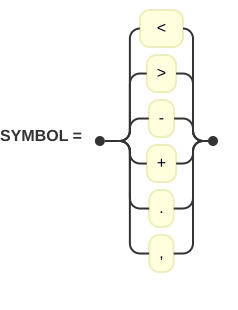
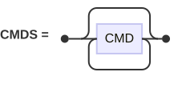
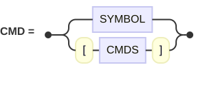

A Brainfuck Interpreter
================================================================================

In this problem, you will write in Lean a complete interpreter for Brainfuck, a
tiny (and deliberately unpleasant) programming language. By the end, this
command will work:

```console
$ lake exe brainfuck hello.bf
Hello World!
```

Along the way, you will use inductive types, recursion over a tree, the
zipper data structure, and monad transformers: `StateT` to run programs and to
parse them, then a combination of `StateT` and `OptionT` to run them one step at
a time.

The work is organized in small steps. Do them in order and make the tests of
each step pass before moving on. Several steps ask you to *rewrite* what you
have just written: this is on purpose, each rewrite introduces one new idea.
Hints are folded: try without them first.

The Language
--------------------------------------------------------------------------------

A Brainfuck program acts on a **tape**: a long row of **cells**, each holding
one byte (a number between 0 and 255). All cells are initially 0. A **head**
designates the **current cell**, and is initially on the first cell of the tape.

| Cell      |  0  |  1  |  2  |  3  |  4  |  5  | ... |
| --------- | :-: | :-: | :-: | :-: | :-: | :-: | :-: |
| **Value** |  0  |  0  |  0  |  0  |  0  |  0  | ... |
| **Head**  |  ▲  |     |     |     |     |     |     |

A program is a sequence of commands, of which there are only eight:

| Command | Effect                                                               |
| :-----: | -------------------------------------------------------------------- |
|   `>`   | move the head one cell to the right                                  |
|   `<`   | move the head one cell to the left                                   |
|   `+`   | add 1 to the current cell                                            |
|   `-`   | subtract 1 from the current cell                                     |
|   `.`   | write the current cell to the standard output, as one byte           |
|   `,`   | read one byte from the standard input and store it in the current cell |
|   `[`   | if the current cell is 0, jump just after the matching `]`           |
|   `]`   | go back to the matching `[`                                          |

The brackets must be balanced, and they form a `while` loop: `[code]` means
"while the current cell is not 0, run `code`". The test occurs *before* each
iteration, so the body may run zero times.

For example, `++[->+++<]` works as follows. The cell 0 is first set to 2. Each
iteration of the loop decrements the cell 0 and adds 3 to the cell 1. When the
loop ends, the cell 0 contains 0 and the cell 1 contains 6: we have multiplied
2 by 3.

The original language leaves a few details open. Here are our conventions:

  - Arithmetic wraps around: `255 + 1` is `0` and `0 - 1` is `255`.

  - Moving left from the first cell does nothing: the head stays where it is.

  - When the input is exhausted (end of file), `,` stores 0.

  - Any character other than the eight commands is an error. Real Brainfuck
    treats these characters as comments, see [Going Further](#going-further).

You can find more details on [Wikipedia](https://en.wikipedia.org/wiki/Brainfuck)
and many code samples on <https://brainfuck.org/>.

### The Examples

Three programs are provided to test your interpreter. They contain nothing but
commands, with no comment and no final newline.

  - `hello.bf` prints `Hello World!`. It first uses a loop to build useful
    values on the tape, which are then adjusted and printed. At the end of this
    setup phase (everything before the first `.`), the tape contains
    `0 0 72 104 88 32 8` and 72 is the ASCII code of `H`.

  - `squares.bf` prints the squares from 0 to 10000, one per line. It takes no
    input and it is a good test of nested loops.

  - `collatz.bf` reads positive integers, one per line, and for each of them
    prints the number of steps needed to reach 1 in the
    [Collatz sequence](https://en.wikipedia.org/wiki/Collatz_conjecture).
    It stops at the end of the input.

The programs `squares.bf` and `collatz.bf` are by Daniel B. Cristofani and come
from <https://brainfuck.org/>. `hello.bf` comes from Wikipedia.

The Abstract Syntax Tree
--------------------------------------------------------------------------------

Put all your code in a file `Brainfuck/Main.lean`, inside `namespace Brainfuck`.

We will not interpret the source text directly but a tree that represents it.
There is no constructor for `[` and `]` taken separately: a loop is a single
command that *contains* the commands of its body.

```lean
abbrev Byte := UInt8

inductive Command where
  | left  -- <
  | right -- >
  | decr  -- -
  | incr  -- +
  | read  -- ,
  | write -- .
  | loop (code : List Command) -- [...]
```

For example, the program `+[->]` is represented by the list
`[.incr, .loop [.decr, .right]]`.

**Task.** Write the instances `ToString Command` and `ToString (List Command)`
so that they reproduce the Brainfuck source code.

```lean
#guard toString Command.incr == "+"
#guard toString (Command.loop [.decr, .right, .incr, .left]) == "[->+<]"
#guard toString [Command.incr, .loop [.loop [.write], .read]] == "+[[.],]"
#guard toString ([] : List Command) == ""
```

<details>
<summary>Hint</summary>

Start with a recursive function `Command.toString (cmd : Command) : String`.
You can apply it to the body of a loop with `List.map`, then glue the resulting
strings together with `"".intercalate`.

Without the instance for `List Command`, Lean would use its generic instance
for lists and display something like `[+, -]`.

</details>

The Tape
--------------------------------------------------------------------------------

A value of type `Tape` represents the content of the cells **and** the position
of the head. A blank tape, filled with zeros and with its head on the first
cell, will be written `{}`, so every field of the structure needs a default
value.

Here is the pure part of the interface. It deals with everything but the input
and output.

```lean
def Tape.current (tape : Tape) : Byte -- the value of the current cell
def Tape.left    (tape : Tape) : Tape
def Tape.right   (tape : Tape) : Tape
def Tape.decr    (tape : Tape) : Tape
def Tape.incr    (tape : Tape) : Tape
```

The following tests apply to steps 1 and 2.

```lean
#guard ({} : Tape).current == 0
#guard ({} : Tape).incr.incr.incr.current == 3
#guard ({} : Tape).decr.current == 255
#guard ({} : Tape).decr.incr.current == 0
#guard ({} : Tape).incr.right.current == 0
#guard ({} : Tape).incr.right.left.current == 1
#guard ({} : Tape).incr.left.current == 1
#guard ({} : Tape).incr.right.incr.incr.left.right.current == 2
```

### Step 1: The Classic Design

**Task.** Implement this interface with the classic design of Brainfuck: an
array of 30,000 bytes and the index of the current cell. When the head is on
the last cell, moving right does nothing.

<details>
<summary>Hint</summary>

`Array.replicate`, `tape.cells[i]!` and `Array.modify` are all you need. Also
remember that the subtraction of natural numbers stops at zero: `0 - 1 = 0`.

</details>

### Step 2: A Growing Tape

The classic design has two flaws: every program pays for 30,000 cells, even if
it uses three of them, and every program is limited to 30,000 cells.

**Task.** Replace your `Tape` with a new implementation, with the same
interface, such that:

  1. The tape grows dynamically. It starts with a single cell, and a new zero
     is added in real time when the head moves right past the last known cell.

  2. Every basic tape action (`current`, `left`, `right`, `decr`, `incr`) is
     done in constant time.

A naive design that stores the cells in a single `List` won't do: reaching the
cell `n` would take `n` steps. But there is a classic data structure, built
from lists, that gives constant time access to a "current" element of a
sequence and to its immediate neighbors: the **zipper**. See the
[Wikipedia page](https://en.wikipedia.org/wiki/Zipper_%28data_structure%29) or
the original article, Gérard Huet,
[*The Zipper*](https://doi.org/10.1017/S0956796897002864),
Journal of Functional Programming, 1997.

<details>
<summary>Hint</summary>

Split the tape in three parts around the head: the cells before it, the current
cell and the cells after it. For the tape `3 1 4 1 5` with the head on `4`:

```
before  = [1, 3]    -- the closest cell comes first!
current = 4
after   = [1, 5]
```

Why is the list `before` stored in reverse order? What happens to these three
fields when the head moves one cell to the left? And what happens when it moves
to the right while `after` is empty?

</details>

All the previous tests should still pass. In addition, the following one should
complete in a second or so, but would practically never end with a naive list:

```lean
#eval Id.run do
  let mut tape : Tape := {}
  for _ in [0:1000000] do tape := tape.right
  for _ in [0:1000000] do tape := tape.left
  return tape.current
-- 0
```

### Step 3: Input and Output

**Task.** Add the two remaining actions. Since they interact with the outside
world, their result lives in `IO`. So that all six actions can later be handled
uniformly, also change the four previous ones to produce a value of type
`IO Tape`.

```lean
def Tape.left  (tape : Tape) : IO Tape
def Tape.right (tape : Tape) : IO Tape
def Tape.decr  (tape : Tape) : IO Tape
def Tape.incr  (tape : Tape) : IO Tape
def Tape.read  (tape : Tape) : IO Tape
def Tape.write (tape : Tape) : IO Tape
```

Here are the input and output functions that you need:

```lean
let stdin <- IO.getStdin
let bytes <- stdin.read 1 -- a ByteArray, which is empty at the end of the input

let stdout <- IO.getStdout
stdout.write (ByteArray.mk #[byte]) -- writes one byte
```

The standard input of `#eval` is empty, so this test should display `H 0`:

```lean
#eval show IO Unit from do
  let mut tape : Tape := {}
  for _ in [0:72] do tape <- tape.incr
  tape <- tape.write
  tape <- tape.right
  tape <- tape.read
  IO.println s!" {tape.current}"
```

### Step 4: The State Monad

Look at how such a tape action is used: it takes a tape and it produces a new
tape, which is passed explicitly to the next action, and so on. Threading a
state by hand from one function to the next is precisely what the `StateT`
monad transformer does for us. Recall that `StateT σ m α` is defined as
`σ → m (α × σ)`, so that the following type is, almost, the type of our actions:

```lean
abbrev Tape.Action := StateT Tape IO Unit
-- which unfolds to: Tape → IO (Unit × Tape)
```

The tape is not a visible argument of the actions anymore:

```lean
def Tape.left  : Action
def Tape.right : Action
def Tape.decr  : Action
def Tape.incr  : Action
def Tape.read  : Action
def Tape.write : Action
```

**Task.** Rework the six actions in two passes.

  1. First use only `get` and `set`:

     ```lean
     def Tape.left : Action := do
       let tape <- get
       set ... -- the new tape
     ```

  2. Then streamline your code. Many of these actions merely apply a pure
     function to the state: this is the job of `modify`. Some questions to guide
     you: Which actions boil down to a single `modify`? If you have kept your
     pure functions from step 2 (under other names), can you reuse them? Which
     action only needs `get`? Which one needs to perform some `IO` before
     changing the state?

Actions now compose with the `do` notation, and `run` executes them from an
initial tape:

```lean
def demo : Tape.Action := do
  Tape.incr
  Tape.right
  Tape.incr
  Tape.incr

#eval do
  let ((), tape) <- demo.run {}
  return tape.current
-- 2
```

The Interpreter
--------------------------------------------------------------------------------

**Task.** Write the function that runs a program:

```lean
partial def Tape.exec (code : List Command) : Action
```

The action `Tape.exec code` runs the commands of `code` in order, from left to
right, on the tape held in the state. The commands other than `loop` are
directly the actions of the previous section. The command `.loop inner` means
"while the current cell is not 0, run `inner`", and then the execution goes on
with the commands that follow the loop.

The keyword `partial` is required here, and not out of laziness: the program
`+[]` never stops, so `Tape.exec` cannot be proved to terminate.

We haven't written a parser yet, so the tests use syntax trees written by hand.
To observe the result, use this helper:

```lean
def finalCell (code : List Command) : IO Byte := do
  let ((), tape) <- (Tape.exec code).run {}
  return tape.current
```

Break the job in two steps.

### Step 1: Without Loops

Write the recursion over the list: nothing to do for the empty list; for
`command :: code`, run `command` then `code`. Temporarily handle the case
`.loop _` by ignoring it.

```lean
#eval finalCell []
-- 0
#eval finalCell [.incr, .incr, .decr]
-- 1
#eval finalCell [.incr, .right, .incr, .incr, .left]
-- 1
```

### Step 2: Loops

Now handle `.loop inner`. Read the current cell with `get` and decide.

<details>
<summary>Hint</summary>

There is no need for a loop construct in your implementation. Use the
recursion, and the following equivalences:

  - if the current cell is 0, then running `.loop inner :: code` is the same as
    running `code`;

  - otherwise, it is the same as running `inner` and then, again,
    `.loop inner :: code`.

</details>

```lean
-- the body is skipped when the current cell is 0
#eval finalCell [.loop [.right, .incr]]
-- 0

-- +++[-]
#eval finalCell [.incr, .incr, .incr, .loop [.decr]]
-- 0

-- ++[->+++<]>
#eval finalCell [.incr, .incr, .loop [.decr, .right, .incr, .incr, .incr, .left], .right]
-- 6

-- ++++++++[>++++++++<-]>+.
def letterA : List Command :=
  List.replicate 8 .incr ++
  [.loop (.right :: List.replicate 8 .incr ++ [.left, .decr])] ++
  [.right, .incr, .write]

#eval (Tape.exec letterA).run' {}
-- A
```

Be careful not to `#eval` a program that never stops, as this would keep your
editor's Lean server busy until you restart it.

A Step-by-Step Interpreter
--------------------------------------------------------------------------------

`Tape.exec` runs a program in one go: once it is started, there is no way to
pause it, to look at the tape halfway through, or to count the commands that
have been executed. In this section, we build a function that performs **a
single step** of the execution. This is very handy to debug a program, and a
function that has no reason to loop forever is also easier to reason about.

The final code will be quite short, but rather abstract, since it combines
several monads. So we will not start there. Steps 1 to 3 only use pattern
matching and `IO`: every value that matters is visible in the code. Steps 4 to 8
then refactor this code, one idea at a time.

The state of the execution is called a **machine**. It holds the tape and what
remains to be run:

```lean
abbrev Program := List Command
abbrev Stack := List Program
abbrev Machine := Stack × Tape
```

Why a stack of programs, and not a single program? Because of the loops. While
we run the body of a loop, we must remember what comes next, once the body is
over. Each element of the stack, called a **frame**, is a program to complete
before moving on to the next frame. A new machine has a single frame, which
holds the whole program: `([code], {})`.

The function `Tape.next?` that we are about to write will perform one step, and
fail when nothing remains to be run. To watch it work, use this helper, which
prints after every step the stack (one string per frame) and the value of the
current cell:

```lean
def trace (code : Program) : IO Unit := do
  let mut machine : Machine := ([code], {})
  repeat
    IO.println s!"{repr (machine.1.map toString)} {machine.2.current}"
    match <- Tape.next? machine with
    | none => break
    | some next => machine := next
```

### Step 1: One Step, Without Loops

**Task.** Write the function below, by pattern matching on the stack:

```lean
def Tape.next? (machine : Machine) : IO (Option Machine)
```

There are three cases:

  - The stack is empty: the program is over, the result is `none`.

  - The top frame is empty: remove it. This counts as one step.

  - The top frame is `command :: code`: run `command` on the tape, and replace
    the top frame with `code`.

Temporarily handle the case `.loop _` by skipping the command.

Recall that a `Tape.Action` is a function in disguise, so you can apply it to a
tape. This gives a value of type `IO (Unit × Tape)`:

```lean
let ((), tape) <- Tape.left tape
```

The code of the six branches will be almost identical. This repetition is
expected, leave it as it is for now!

```lean
#eval trace [.incr, .right, .incr]
-- ["+>+"] 0
-- [">+"] 1
-- ["+"] 0
-- [""] 1
-- [] 1
```

### Step 2: Loops

**Task.** Handle the case `.loop inner`, when the top frame is
`.loop inner :: code`.

<details>
<summary>Hint</summary>

If the current cell is 0, the loop is over and the case is similar to the other
commands: the top frame becomes `code`.

Otherwise, `inner` must become the new top frame. Just below it, keep the frame
**with the loop still at its head**, so that the test is performed again when
`inner` is over.

</details>

```lean
#eval trace [.incr, .loop [.decr], .right]
-- ["+[-]>"] 0
-- ["[-]>"] 1
-- ["-", "[-]>"] 1
-- ["", "[-]>"] 0
-- ["[-]>"] 0
-- [">"] 0
-- [""] 0
-- [] 0
```

### Step 3: Running a Machine

**Task.** Write a function that repeats `Tape.next?` until it returns `none`,
and then returns the last machine. Use it to observe the final cell:

```lean
partial def Machine.run (machine : Machine) : IO Machine

def finalCell' (code : Program) : IO Byte := do
  let (_, tape) <- Machine.run ([code], {})
  return tape.current
```

Only `Machine.run` needs `partial`: `Tape.next?` is not recursive, and always
completes.

You now have a second interpreter, which must agree with `Tape.exec`:

```lean
#eval finalCell' []
-- 0
#eval finalCell' [.incr, .right, .incr, .incr, .left]
-- 1
#eval finalCell' [.loop [.right, .incr]]
-- 0
#eval finalCell' [.incr, .incr, .incr, .loop [.decr]]
-- 0
#eval finalCell' [.incr, .incr, .loop [.decr, .right, .incr, .incr, .incr, .left], .right]
-- 6
```

### Step 4: The Machine Monad

The code works, but look at what it does by hand: it passes a machine along, and
wraps its results in `some` or `none`. Each of these two chores corresponds to a
monad transformer: `StateT` handles a state and `OptionT` adds the possibility
of failure. Let's stack them on top of `IO`:

```lean
abbrev Machine.Step := StateT Machine (OptionT IO)
```

This definition is less mysterious when it is unfolded, one layer at a time:

```lean
Machine.Step α
-- is StateT Machine (OptionT IO) α
-- is Machine → OptionT IO (α × Machine)
-- is Machine → IO (Option (α × Machine))
```

With `α := Unit`, this is the type of step 1, plus a useless `Unit`. Each layer
brings its own operations, and all of them are available in a single `do` block:

| Layer             | What it provides                                   |
| ----------------- | -------------------------------------------------- |
| `StateT Machine`  | `get` and `set`, instead of passing a machine      |
| `OptionT`         | `failure`, instead of `return none`                |
| `IO`              | input and output; these actions are lifted for you |

**Task.** Rewrite your function with the signature below, using `get`, `set` and
`failure`. Do nothing else for now: keep the same case analysis and the same
repeated branches. Lean automatically lifts a value of type `IO α` in this
monad, so the line `let ((), tape) <- Tape.left tape` doesn't change.

```lean
def Tape.next? : Machine.Step Unit
```

`Tape.next? machine` now has the type `OptionT IO (Unit × Machine)` and we get
back to `IO` with `.run`. So adapt `trace` as follows, and do the same in
`Machine.run`:

```lean
    match <- (Tape.next? machine).run with
    | none => break
    | some ((), next) => machine := next
```

The traces of steps 1 and 2 and the tests of step 3 must not change.

### Step 5: Fetching the Next Command

Every branch of `Tape.next?` mixes two different jobs: finding the next command
and executing it. Let's separate them.

**Task.** Write a function that removes the next command from the stack and
returns it. It skips the empty frames and fails if there is no command left.

```lean
partial def Machine.advance : Machine.Step Command
```

Why `partial`, again? To skip the empty frames, the function calls itself, and
the state is hidden from Lean, which cannot see that the stack gets smaller.

**Task.** Rewrite `Tape.next?` so that it starts as follows:

```lean
def Tape.next? : Machine.Step Unit := do
  let command <- Machine.advance
  let (stack, tape) <- get
  match command with
  ...
```

The branches get simpler, as the stack is already up to date: there is no
`code` to deal with anymore. But there is a catch with loops: if the current
cell is not 0, the loop must be tested again later, and `Machine.advance` has
just removed it. Fortunately, the frame it came from is still at the top of the
stack. So pattern match on the stack to put the loop back at the head of that
frame, and then push `inner` above it, like in step 2.

The stack cannot be empty at this point, as `Machine.advance` has succeeded, but
Lean doesn't know that. Handle this case with `unreachable!`, which panics if it
is ever evaluated.

Note that the empty frames do not take one step of their own anymore: a step now
executes exactly one command. The traces do change:

```lean
#eval trace [.incr, .right, .incr]
-- ["+>+"] 0
-- [">+"] 1
-- ["+"] 0
-- [""] 1

#eval trace [.incr, .loop [.decr], .right]
-- ["+[-]>"] 0
-- ["[-]>"] 1
-- ["-", "[-]>"] 1
-- ["", "[-]>"] 0
-- [">"] 0
-- [""] 0
```

The tests of step 3 must still pass.

### Step 6: Lifting the Tape Actions

The six branches for the tape actions still follow the same pattern. A tape
action only knows about the tape. It cannot fail and it doesn't touch the stack,
so we have to adapt it to the machine.

**Task.** Proceed in two passes.

  1. Extract the common pattern of the six branches. You can copy their code
     almost verbatim, using `get` and `set`:

     ```lean
     def Machine.liftAction (action : Tape.Action) : Machine.Step Unit
     ```

     Each branch now looks like `.left => Machine.liftAction Tape.left`. Move
     the code of the loop branch to its own definition as well, and notice that
     the `if` doesn't need an `else`: when the loop is skipped, the command has
     already been removed and there is nothing left to do.

     ```lean
     def Machine.nextInLoop (inner : Program) : Machine.Step Unit
     ```

  2. What does `liftAction` actually do? Write it again without `get` and `set`,
     as a plain function. It must turn a value of type `Tape → IO (Unit × Tape)`
     into a value of type `Machine → IO (Option (Unit × Machine))`.

<details>
<summary>Hint</summary>

Start from the machine, as an explicit argument:

```lean
def Machine.liftAction (action : Tape.Action) : Machine.Step Unit :=
  fun ((stack, tape) : Machine) => do
    let ((), tape) <- action tape
    ...
```

To end this block, build the expected value and tell Lean which monad you are
in, so that it picks the right `pure`:

```lean
    (pure ... : IO (Option (Unit × Machine)))
```

</details>

### Step 7: An Automatic Conversion

We have to write `Machine.liftAction` in six places, though there is only one
sensible way to use a `Tape.Action` as a `Machine.Step Unit`. Lean can insert
this conversion on its own if we declare it as a coercion.

**Task.** Add the following instance, and remove every explicit call to
`Machine.liftAction` from `Tape.next?`.

```lean
instance : Coe Tape.Action (Machine.Step Unit) where
  coe := Machine.liftAction
```

You should end up with a definition that reads like a specification of the
language:

```lean
def Tape.next? : Machine.Step Unit := do
  let command <- Machine.advance
  match command with
  | .left => Tape.left
  ...
  | .loop inner => Machine.nextInLoop inner
```

### Step 8: A More Precise Type

Look again at `Machine.advance`. It works on the machine and may fail, but it
performs no input or output, and its type should say so:

```lean
abbrev Machine.Step.Pure := StateT Machine Option
-- so Machine.Step.Pure α unfolds to: Machine → Option (α × Machine)
```

**Task.** Rename your function to `Machine.advancePure` and give it the type
below. If you did the previous steps, its code doesn't change at all, except for
the name of the recursive call.

```lean
partial def Machine.advancePure : Machine.Step.Pure Command
```

**Task.** Define `Machine.advance` on top of it, as a plain function, like you
did for `liftAction`. This time, you need to get a term of type
`Machine → IO (Option (Command × Machine))` from a term of type
`Machine → Option (Command × Machine)`.

```lean
def Machine.advance : Machine.Step Command
```

<details>
<summary>Hint</summary>

```lean
def Machine.advance : Machine.Step Command :=
  fun (machine : Machine) =>
    let result : Option (Command × Machine) := Machine.advancePure machine
    ...
```

The value `result` has no effect to perform, so `pure` is all it takes to bring
it to `IO`. As in the previous hint, annotate its type so that Lean selects the
right `pure`.

</details>

Is it worth it? Having `Machine.advance` written directly in `Machine.Step`, as
in step 5, is perfectly pragmatic. The pure version requires an extra conversion,
but its type guarantees that it will never print anything.

All the tests and the traces of step 5 must still pass. For a last check, this
program should print the letter `A`:

```lean
#eval do
  let _ <- Machine.run ([letterA], {})
```

The Parser
--------------------------------------------------------------------------------

The goal of this section is to turn source code into a syntax tree:

```lean
def parse (source : String) : Except String (List Command)
```

A parser consumes the beginning of a list of characters. It either fails, or
produces a value along with the remaining characters. Parsers are made by
combining smaller ones, which we will build from the bottom up.

The syntax of Brainfuck boils down to three rules, which the following steps
present as **railroad diagrams**. To read such a diagram, enter at the left dot
and follow the tracks to the right dot, as a train would: smoothly and without
reversing. Every possible journey spells out a text that the rule accepts.

  - A yellow box with rounded corners is a character that must be there.

  - A blue rectangular box is another rule, which must be satisfied at this
    point.

  - A fork is a choice between several tracks.

Each diagram tells you what the corresponding parser must do.

### Step 1: One Symbol, by Hand

The simplest rule says that a `SYMBOL` is one of six characters:

<p align="center">

</p>

There is one track per character. Any other character, or the end of the input,
leaves the train with no track to follow: the parser must then fail.

**Task.** Write a function that recognizes the six commands other than the
brackets:

```lean
def parseSymbol (chars : List Char) : Option (Command × List Char)
```

For example, it maps `['+', '-']` to `some (.incr, ['-'])`, and both `['@']`
and `[]` to `none`.

### Step 2: The Parser Monad

Once again, a state is passed around by hand: the remaining characters. And once
again, there is a monad for that, this time on top of `Option`:

```lean
abbrev Parser := StateT (List Char) Option
-- so Parser α unfolds to: List Char → Option (α × List Char)
```

**Task.** Rewrite `parseSymbol` with the signature below, using `get`, `set`,
`return` and `failure`.

```lean
def parseSymbol : Parser Command
```

Note that `Parser α` is a function: you run a parser by applying it, or with
`run`.

```lean
#guard (parseSymbol.run ['+', '-']).isSome
#guard (parseSymbol.run ['@']).isNone
#guard (parseSymbol.run []).isNone
```

### Step 3: The Brackets

The characters `[` and `]` are missing from the `SYMBOL` diagram. They will
appear in the diagram of step 5, on each side of the body of a loop.

**Task.** Write two parsers which consume one bracket and produce nothing
interesting. Avoid repeating yourself: you may first write a more general
parser that recognizes any given character.

```lean
def parseOpeningLoop : Parser Unit
def parseClosingLoop : Parser Unit
```

```lean
#guard (parseOpeningLoop.run ['[', '+']).map (·.2) == some ['+']
#guard (parseOpeningLoop.run ['+']).isNone
#guard (parseClosingLoop.run [']']).map (·.2) == some []
```

### Step 4: Repetition

The next rule says that `CMDS`, a sequence of commands, is made of zero or more
`CMD`. We will come to `CMD` itself in step 5.

<p align="center">

</p>

The upper track skips the box altogether, which accounts for zero occurrences.
Otherwise, the train goes through the box and can take the lower track to come
back before it, as many times as needed. This shape doesn't depend on what is
inside the box, so we will write it once and for all, for any parser.

**Task.** Write a combinator that applies a parser as many times as possible
and collects the results.

```lean
partial def parseZeroOrMore {α} (p : Parser α) : Parser (List α)
```

Use a `try ... catch` block: try to run `p` and then, recursively,
`parseZeroOrMore p`; if `p` fails, return the empty list. Such a parser never
fails: whatever the input, there is always a track that avoids the box.

Note a very handy property of our monad: when an error is caught, the handler
starts again **with the state as it was at the start of the `try`**. A parser
that fails after having consumed some characters therefore "gives them back",
without any effort on your part. (Do you see why this comes from the definition
of `StateT`?)

```lean
#guard (parseZeroOrMore parseSymbol |>.run ['+', '-', '@', '+']).map
  (fun (r, s) => (r.length, s)) == some (2, ['@', '+'])
#guard (parseZeroOrMore parseSymbol |>.run ['@']).map
  (fun (r, s) => (r.length, s)) == some (0, ['@'])
#guard (parseZeroOrMore parseSymbol |>.run []).map
  (fun (r, s) => (r.length, s)) == some (0, [])
```

### Step 5: Commands and Nested Loops

A command is either a symbol or a loop, and a loop is an opening bracket, some
commands, and a closing bracket:

<p align="center">

</p>

For example, here is the journey for the source code `[+-]`. The train takes
the lower track of the fork and reads `[`. It then enters the `CMDS` diagram of
step 4 and goes twice through its `CMD` box, each time by the upper track of the
fork above, to read `+` and then `-`. Finally, it leaves `CMDS` and reads `]`.

Every box of this diagram corresponds to a parser:

| Box      | Parser             |
| :------: | ------------------ |
| `SYMBOL` | `parseSymbol`      |
| `[`      | `parseOpeningLoop` |
| `CMDS`   | `parseCommands`    |
| `]`      | `parseClosingLoop` |

The `CMD` diagram contains a `CMDS` box and the `CMDS` diagram contains a `CMD`
box. This circularity is what allows loops to be nested, and it means that the
corresponding parsers must be declared in a `mutual` block:

```lean
mutual

partial def parseCommands : Parser (List Command) := ...

partial def parseCommand : Parser Command := ...

end
```

**Task.** Implement them. The first is a one-liner with `parseZeroOrMore`. The
second follows the fork of the `CMD` diagram: it tries `parseSymbol` and, if it
fails, parses a loop by going through the three boxes of the lower track.

Why do the commands of a loop stop at the right place? On the character `]`,
`parseCommand` fails, so `parseZeroOrMore` stops and leaves `]` in place for
`parseClosingLoop`.

### Step 6: The Complete Parser

A program is valid when the `CMDS` diagram accounts for all of its source code,
from the first character to the last.

**Task.** Write `parse`, using `String.toList` and `parseCommands`. Three cases
are possible when you run `parseCommands`:

  - it fails, which cannot happen since `parseZeroOrMore` never fails. You can
    use `unreachable!`;

  - it leaves no character unread, and the result is `.ok commands`;

  - some characters remain, and the result is an `.error` with a message
    which displays them (use `String.ofList`).

```lean
#eval parse ""
-- ok:
#eval parse "+-"
-- ok: +-
#eval parse "[+-]"
-- ok: [+-]
#eval parse "+[[.],]>"
-- ok: +[[.],]>
#eval parse "@"
-- error: parse failed at @
#eval parse "+ -"
-- error: parse failed at  -
#eval parse "]"
-- error: parse failed at ]
#eval parse "+]-"
-- error: parse failed at ]-
#eval parse "+-[+-"
-- error: parse failed at [+-
#eval parse "[[+]"
-- error: parse failed at [[+]
```

Look at the last two tests: thanks to the backtracking of step 4, the error
points at the start of the loop that is not closed.

The CLI
--------------------------------------------------------------------------------

Time to put everything together in a program, with the following behavior:

| Situation                     | Expected behavior                                     | Exit code |
| ----------------------------- | ----------------------------------------------------- | :-------: |
| no argument                   | print `Usage: brainfuck [FILE.bf]`                    |     1     |
| the file doesn't parse        | print the error message on the standard error         |     1     |
| the file parses               | run the program from a blank tape                     |     0     |

Don't bother with the case of a missing file: `IO.FS.readFile` raises an
exception, Lean displays it, and the program exits with the code 1.

**Task.** Proceed by small steps, and test each of them.

  1. Declare the executable in `lakefile.toml`, if needed:

     ```toml
     [[lean_exe]]
     name = "brainfuck"
     root = "Brainfuck.Main"
     ```

  2. After `end Brainfuck`, at the top level of the file, add an entry point
     that only prints the usage.

     ```lean
     def main (args : List String) : IO UInt32
     ```

     Check that `lake exe brainfuck` displays the usage.

  3. Match on `args`: for `filename :: _`, read the file with `IO.FS.readFile`
     and call `Brainfuck.parse`. Print the error message with `IO.eprintln` when
     there is one.

  4. In the remaining case, run the program from a blank tape. Since
     we don't care about the final tape, `run'` is all you need:
     `(Brainfuck.Tape.exec code).run' {}`.

Finally, test the three provided examples from the root of your project. If
your source file still contains `#eval` commands, `lake` will display their
results too (on the standard error), which you can ignore.

```console
$ lake exe brainfuck Brainfuck/hello.bf
Hello World!
```

The program `squares.bf` should print 101 lines, from 0 to 10000:

```console
$ lake exe brainfuck Brainfuck/squares.bf | head -n 4
0
1
4
9
$ lake exe brainfuck Brainfuck/squares.bf | tail -n 2
9801
10000
$ lake exe brainfuck Brainfuck/squares.bf | wc -l
101
```

The program `collatz.bf` needs some input. Every number must be followed by a
newline, including the last one:

```console
$ printf '1\n2\n3\n7\n27\n' | lake exe brainfuck Brainfuck/collatz.bf
0
1
7
16
111
```

You can also run it interactively: type a number, press Enter, and press
Ctrl+D to stop.

Going Further
--------------------------------------------------------------------------------

These extensions are optional.

  - **Comments.** In real Brainfuck, every character other than the eight
    commands is a comment. This is why our parser cannot read most programs found
    on <https://brainfuck.org/>, and why it would even reject a file with a
    final newline. Fix this by filtering the source code before parsing. Which
    of the tests of `parse` change? Which errors remain possible? Then download
    <https://brainfuck.org/squares.b> and run it.

  - **Termination.** `Tape.exec` has to be `partial`, but is it also the case
    of the parser? Each successful step of `parseCommand` consumes at least one
    character, so the parser always stops. Can you get rid of `partial`
    and have Lean accept your definitions?

  - **A total `advance`.** `Machine.advancePure` is `partial`, so nothing can be
    proved about it. Write it instead as a function on `Machine` that pattern
    matches on the stack, with `termination_by machine => machine.1.length`.
